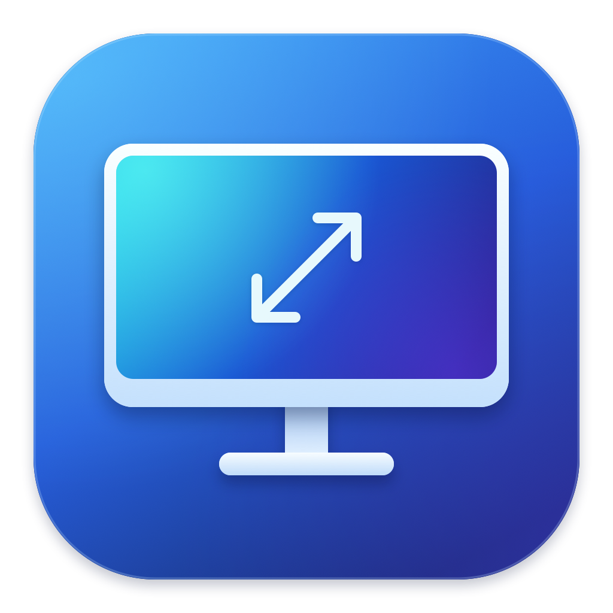

# SmartDPI



**为在 macOS 上未适配 HiDPI 的显示器提供缩放工具。**

SmartDPI 是一个原生 macOS 显示缩放工具，面向在 macOS 上没有适配 HiDPI、缺少 HiDPI 选项或缺少合适缩放尺寸的显示器。无论是 1080p、2K、4K、超宽屏还是其他分辨率，都可以读取实际模式并尝试提供 HiDPI 缩放选项；具体可用组合以系统和硬件的实际能力为准。它把系统已有模式与可补充的 HiDPI 尺寸放在同一个列表里，让你直接从菜单栏选择。

以 2K 显示器为例：你的显示器是 **2560 × 1440 的面板**，但希望文字和窗口具有 **1920 × 1080 的大小**。选择 `1920 × 1080 · HiDPI 开` 后，物理面板仍是 2560 × 1440，macOS 通过更高分辨率绘制再缩放来显示内容。这个例子用于说明缩放效果；SmartDPI 的用途不限于 2K 显示器。HiDPI 不会增加面板的物理像素。

## 解决什么问题

- **显示器在 macOS 上没有适配 HiDPI，或系统缺少合适的 HiDPI 尺寸。** 普通模式下文字可能不够细腻，原生桌面大小也可能不适合阅读；SmartDPI 会识别已有模式，并尝试补充适合该屏幕的 HiDPI 尺寸。
- **同一个分辨率出现多次，用户分不清该选哪个。** 列表统一按“看起来像”的桌面大小显示，明确标记 `HiDPI 开 / 关`，并标出可用刷新率。
- **每次调整缩放都要进系统设置。** 菜单栏面板可直接切换分辨率与刷新率，点击立即生效，无需再次确认保留。
- **切换尺寸后意外掉到低刷新率。** “自动”优先保持当前频率，并匹配目标尺寸实际支持的模式；无法满足时会说明原因，不承诺硬件未提供的 Hz。

## 下载与安装

**[下载最新版本](https://github.com/wecomed/SmartDPI/releases/latest)**

支持 **Apple Silicon（M1 及后续 M 系列）/ macOS 13 或更新版本**。下载发布页中的 macOS arm64 应用压缩包，解压后将 `SmartDPI.app` 拖到“应用程序”并打开。

当前应用采用临时签名，尚无 Apple Developer ID 签名或公证。首次打开如被系统拦截，请根据 macOS 的提示在“系统设置 → 隐私与安全性”中查看是否允许打开。

虚拟 HiDPI 使用实验性的系统接口。可用分辨率与刷新率取决于 Mac、显示器、线材、连接方式及 macOS；目前实机验证范围见下方“兼容性与恢复”，并非所有 M 系列机型均已逐台验证。

## 主要功能

- 菜单栏快捷调整，主窗口和菜单栏使用同一份分辨率列表。
- 明确显示当前实际生效的桌面大小、HiDPI 状态和系统报告的刷新率。
- 自动匹配刷新率，也可选择系统报告的具体频率，包括小数 Hz。
- 优先使用 macOS 已有模式；需要时通过虚拟显示与系统镜像补充 HiDPI。
- 多显示器选择，按每台屏幕的尺寸与实际模式生成选项。
- 一键恢复原设置；虚拟显示在停止、退出、休眠或断开连接时清理。
- SwiftUI 原生界面，采用 macOS 27 系统外观，跟随深浅色与降低透明度设置。

## 为什么系统设置中会多出镜像

macOS 的公开接口可以选择已有显示模式，无法直接创建所有缺失的 HiDPI 模式。SmartDPI 在需要补充尺寸时创建 `SmartDPI HiDPI` 虚拟屏幕，再由 macOS 将其镜像到物理显示器，因此系统设置会显示镜像关系。这条路径需要 SmartDPI 保持运行，退出会恢复启用前的显示设置。

如果系统已提供目标 HiDPI，SmartDPI 会优先直接使用它。当前没有实现 BetterDisplay 的原生 Flexible Scaling 配置路径；具体机制、性能与恢复边界见下文。

## 日常使用（0.6.0）

1. 连接显示器，打开应用，点击 macOS 顶部菜单栏的显示器图标。面板标题和主窗口侧栏都显示版本号。多显示器时先选择目标屏幕。
2. 在同一个列表里选择分辨率，例如 `1920 × 1080 · HiDPI 开`。同尺寸的 `HiDPI 关` 使用普通绘制；尺寸数值越小，文字和窗口越大。
3. **点击立即应用并自动保留，不需要第二次确认，也没有倒计时。** 勾选始终表示当前实际桌面大小。主窗口和菜单栏使用相同的列表与操作。
4. 刷新率默认“自动”，优先保持当前频率，切换尺寸时按该尺寸支持的实际频率匹配。直接修改刷新率也立即生效。各行右侧显示将使用的频率，顶部显示系统报告的当前值。
5. 系统已有模式优先使用；缺少的 HiDPI 尺寸会自动使用 SmartDPI 的虚拟显示方案。用户无需选择两种来源。补充模式会在悬停说明中注明需保持软件运行；创建失败会显示原因并请求恢复。
6. 需要返回时点击“恢复原设置”。系统模式恢复至上次切换前的设置；虚拟 HiDPI 恢复至启用虚拟显示前的物理显示配置。使用虚拟 HiDPI 时也可以直接选择另一行，软件会处理模式切换。停止、退出或睡眠时会清理虚拟显示。

HiDPI 改善渲染与界面大小，无法增加面板的物理像素。文字锐度与可用刷新率还受显示器、接口、线材和 GPU 影响。USB-C 与 HDMI 的模式列表可能不同，切换连接方式后请重新读取。

## 菜单栏快捷面板

菜单栏使用固定宽度的显示器图标，当前 HiDPI 状态在面板里显示。分辨率、普通/HiDPI 选项全部放在一个按尺寸排序的列表中；不再需要切换“系统模式 / 兼容模式”或展开普通模式。

面板高度在每次打开时确定，切换期间保持不变。主窗口和面板使用固定行高、固定反馈区域、稳定列表 ID 和排序，避免插入提示造成内容位移；显示模式的回调合并后一次更新界面。主窗口支持 640 × 440 的紧凑尺寸。macOS 因桌面空间改变而调整窗口位置的行为仍由系统控制。

内部渲染尺寸由模式自动决定，可展开“显示详情”查看。主窗口与菜单栏的选择均立即生效；恢复入口始终可见。读取、切换和恢复期间暂时禁用控件，外部镜像显示需先在系统设置中解除。

## 2K 面板为什么会出现 4K 渲染画布

以物理尺寸为 **2560 × 1440** 的面板为例，桌面尺寸、渲染画布和物理像素是三件不同的事：

| 看起来像 | 2× HiDPI 渲染画布 | 使用效果 |
| --- | --- | --- |
| 1280 × 720 | 2560 × 1440 | 整数 2× 映射，界面较大 |
| 1920 × 1080 | 3840 × 2160 | 渲染后缩放到面板，界面大小较适中 |
| 2560 × 1440 | 5120 × 2880 | 保持相同工作空间，需要更多渲染资源 |

3840 × 2160 是中间画布，面板仍然只有 2560 × 1440 个物理像素。画布尺寸也不能单独证明接口传输的信号分辨率。以上为原理示例，能否提供对应的 HiDPI 与刷新率组合取决于系统和硬件。

## 适配的实际场景

- **不同分辨率的显示器在 macOS 上没有 HiDPI**：面向 1080p、2K、4K、超宽屏等场景，识别已有模式，优先选择系统 HiDPI，缺少时尝试兼容路径；可用性取决于实际设备和连接。
- **文字清晰但大小不舒服**：分别选择桌面大小和该尺寸实际支持的 Hz，不把降低普通分辨率标记为 HiDPI。
- **高刷屏或切换接口**：按模式重新枚举 59.94、60、75、120、144、165、240 Hz 等系统实际报告值，保留小数 Hz；不会从 75 Hz 普通模式推断某个 HiDPI 尺寸也支持 75 Hz。
- **4K、超宽或竖屏、多显示器**：根据每台屏幕报告的原生尺寸或明确标记的估计值生成兼容缩放选项；切换显示器时重置并匹配新屏幕当前选择。
- **睡眠、拔线、系统或其他应用修改模式**：重新读取可用模式；兼容模式失效时停止并请求恢复，保留失败恢复的重试入口。启动和重新连接不会擅自应用上次的虚拟模式。

## 已实现的行为

- 读取实际连接的显示器、桌面尺寸、渲染像素和刷新率。
- 根据两个方向的桌面 / 像素尺寸识别 HiDPI，按尺寸分组并保留不同刷新率的模式。
- 原生模式立即应用，核对实际模式后自动完成；独立子进程只保护尚未完成验证的切换。
- 实验性虚拟屏幕 + 系统镜像，先验证精确 2× 尺寸和请求的刷新率，再连接物理显示器；建立镜像后再次核对。
- 停止、退出、休眠和断开连接时清理虚拟屏幕；不会自动重新启用。
- 菜单栏操作与 JSON 诊断导出（不包含显示器硬件序列号）。

## 性能与镜像方式

SmartDPI 优先使用 macOS 已有的显示模式。缺少所需 HiDPI 尺寸时，建立一个由系统管理的虚拟屏幕，并让物理显示器镜像它，因此系统设置中会多出 `SmartDPI HiDPI` 和镜像关系。显示详情会解释该状态；这条路径需要应用保持运行。

BetterDisplay 也提供虚拟镜像，但它的首选 Flexible Scaling 是修改系统显示配置，让兼容的直接连接屏幕使用原生缩放，通常无需虚拟镜像。SmartDPI 当前尚未实现此配置路径，不能认为两者实现完全相同。[BetterDisplay 官方指南](https://betterdisplay.pro/guide/tutorials/fully-scalable-hidpi-desktop/)

0.6.0 采用显示变化事件驱动刷新，30 秒完整扫描作为后备。只有正在运行虚拟镜像时才每 3 秒做一次轻量状态检查；列表与已验证的当前模式缓存后供界面读取。计划内完整扫描由每分钟 20 次降为 2 次；这不表示 CPU 或内存必然减少 90%。

2026-10-26，在本机 Apple M6 / macOS 27.0.1 已运行的 0.5.0 上，读取到 `1920 × 1080` 桌面、`3840 × 2160` 渲染、75 Hz 镜像。30 秒静置采样平均 CPU 为 **0.033%**（100% 表示一个逻辑核心），RSS 常驻内存为 **132.84–139.86 MiB**，均值 **134.73 MiB**。这是该会话的样本，不是峰值、长期稳定性或所有 M 芯片的基准。RSS 与活动监视器的物理内存计量不同。

更新并启动 0.6.0 后，显示器恢复为普通 `2560 × 1440 / 75 Hz`，未开启镜像。另一次 30 秒静置采样未记录到可分辨的 CPU 时间增长（报告 0.0%），RSS 为 **118.06–118.11 MiB**。由于两次显示模式不同，不能用它们推算版本升级的性能收益。

App 进程的数值不包含全部 GPU、WindowServer 和各应用绘制内存。1080p HiDPI 的内部画布像素数是普通 2560 × 1440 桌面的 2.25 倍；高刷新率、视频和动画会增加图形工作量，不能从低 App CPU 推断镜像没有额外开销。[BetterDisplay 性能说明](https://betterdisplay.pro/guide/faq/scaling/hidpi-performance/)

可通过以下只读脚本重复测量同一工作负载；比较版本时，应保持桌面尺寸、刷新率、窗口可见性与活动内容一致：

```sh
python3 scripts/measure-performance.py <SmartDPI的PID> --seconds 30 --output /tmp/SmartDPI-performance.json
```

## Apple Silicon 与系统外观

发布目标是 M1 及后续 M 系列，包括相应 Pro / Max / Ultra 型号。采用标准 arm64，不按开发机芯片优化指令，也没有芯片名称白名单。构建使用本机当前 SDK，最低运行目标保留 macOS 13；系统控件在新系统使用当前原生外观，旧系统使用可用的标准样式。

可运行架构与可用显示模式是两个范围：公开 CoreGraphics 模式直接读取；缺失模式通过运行时检查虚拟显示接口，并核对系统实际提供的 2× 尺寸、刷新率和镜像结果。某款 GPU、连接或 macOS 不接受的组合会报错并恢复，不能承诺每台 M 系列机器都提供相同分辨率或刷新率。逻辑尺寸上限 3840 × 2160 是本工具的请求范围，不是硬件能力检测结果。

目前本机验证环境是 Apple M6 / macOS 27.0.1；没有逐台测试其他 M 系列或 macOS 13–26。诊断导出包含运行架构和构建 SDK，便于定位不同设备的差异。

界面采用系统侧栏、工具栏、菜单和选择控件；少量操作按钮使用原生玻璃样式，内容列表保留普通背景。颜色与材质跟随深浅色及“降低透明度”设置，不为每一行叠加玻璃效果。新图标采用简洁显示器与缩放箭头，并包含 16–1024 像素的图标资源。

## 兼容性与恢复

原生模式切换使用公开 CoreGraphics API。它能选择系统已有的模式，不能凭空解锁系统未提供的 HiDPI。

虚拟屏幕使用未公开的 `CGVirtualDisplay` 接口，通过运行时检查及错误处理降低兼容性问题；这不构成 Apple 对该接口的支持保证。兼容模式的候选刷新率来自目标屏幕实际报告的普通 / 原生模式，优先保持当前频率；无法读取时不会猜测为 60 Hz。选中的虚拟 Hz 必须由系统发布并在镜像后核对，失败时恢复而非静默降频。虚拟模式 Hz 不等于独立测量的物理扫描频率，界面会注明未取得独立读数。

兼容桌面尺寸上限为 **3840 × 2160**，2× 渲染画布上限为 **7680 × 4320**；这只是本工具的请求范围，不表示所有 Mac / 显示器都能接受。候选频率只取系统报告的有限正数，最多接受 1000 Hz 请求，不承诺硬件支持该上限。已经参与其他镜像的显示器需要先在系统设置中解除镜像。面板尺寸只信任一致的 1:1 系统原生标记；从普通模式推算时标记“估计”，不会把 HiDPI 画布当成面板像素。

系统模式成功应用后对当前登录会话有效，不写入系统启动时的永久配置，也不会因退出 SmartDPI 自动撤销。切换失败时自动请求恢复；原生切换若因进程卡住而未完成验证，独立子进程会在 30 秒内请求恢复。成功验证后立即通知子进程结束，不存在正常使用时的超时回退。

虚拟镜像配置限本应用生命周期，并保存启用前的模式和排列。连续选择另一个尺寸时，会先释放旧虚拟屏并恢复物理显示，再设置新尺寸；中途失败会回到物理显示配置。此过程可能有系统切换显示模式时的短暂闪屏。

如已生效的设置不合适，点击“恢复原设置”。虚拟 HiDPI 也可通过退出 SmartDPI 释放；重新登录可清除本工具的会话配置。应用不会在启动时恢复上次的虚拟模式。

不修改显示器 EDID、系统 Overrides、SIP 或管理员设置。只使用系统镜像，无需屏幕录制权限。

**验证边界：** 已有只读诊断识别到 `P27QBA-RA` 的物理尺寸为 `2560 × 1440`，系统模式包括 `1280 × 720 HiDPI`，当时未提供 `1920 × 1080 HiDPI`；可用模式会随连接和系统设置改变。本次在用户已经启用的虚拟镜像中，读取到 `1920 × 1080` 桌面、`3840 × 2160` 渲染和系统报告的 75 Hz，并完成 30 秒静置性能采样。0.6.0 版通过 69 项测试，覆盖统一列表、去重、刷新率、实际状态、缓存与误操作防护；应用包签名、arm64 架构与 macOS 27 SDK 链接信息校验通过。已检查浅色、深色和 640 × 440 紧凑窗口的离屏布局；离屏位图不能完整复现系统玻璃材质，实际合成外观仍需在正常窗口查看。本次未自动反复切换用户屏幕，也未完成其他芯片、高负载、色彩、窗口定位与睡眠唤醒的实机测试。执行沙盒内可能无法读取显示器或初始化 AppKit，应用应在正常 macOS 会话中启动。

## 从源码构建

需要 Apple Command Line Tools 与 macOS SDK（运行测试需 Swift 6），项目没有第三方包依赖。构建脚本使用当前 SDK、标准 arm64 指令集和项目内缓存，最低运行目标为 macOS 13，并为本机应用执行临时签名。

```sh
git clone https://github.com/wecomed/SmartDPI.git
cd SmartDPI
./scripts/build-app.sh
open dist/SmartDPI.app

# 将已构建应用打包，并生成安装说明和 SHA256 校验文件
./scripts/package-release.sh
```

## 开发与只读诊断

使用 SwiftUI、CoreGraphics 与 Swift Package Manager，没有第三方包依赖。构建需要 Apple Command Line Tools 与 macOS SDK，运行 Swift Testing 测试需 Swift 6。构建脚本使用本项目的缓存目录，并生成标准 arm64 应用包。

```sh
./scripts/build-app.sh
open dist/SmartDPI.app
```

生成的 `dist/SmartDPI.app` 可在 Finder 中双击打开，也可拖到“应用程序”。构建脚本对应用执行临时签名，不包含 Developer ID 签名或公证。

```sh
# 缓存写入当前项目，适用于受限环境
export CLANG_MODULE_CACHE_PATH="$PWD/.build/ModuleCache"
export SWIFTPM_MODULECACHE_OVERRIDE="$PWD/.build/ModuleCache"
./scripts/test.sh

# 读取系统当前显示器及模式，不切换设置
.build/debug/SmartDPI --diagnostics

# 使用明确标注的示例设备预览 UI，不修改显示设置
.build/debug/SmartDPI --demo

# 离屏渲染界面供布局检查
.build/debug/SmartDPI --render-preview /tmp/SmartDPI-preview.png
.build/debug/SmartDPI --render-preview /tmp/SmartDPI-compact.png --compact-preview
.build/debug/SmartDPI --render-preview /tmp/SmartDPI-menu.png --menu-preview --hidpi-preview
.build/debug/SmartDPI --render-preview /tmp/SmartDPI-menu-details.png --menu-preview --hidpi-preview --details-preview
```

公开接口依据：[Apple 模式枚举](https://developer.apple.com/documentation/coregraphics/cgdisplaycopyalldisplaymodes(_:_:))、[配置的生效范围](https://developer.apple.com/documentation/coregraphics/cgconfigureoption)、[系统镜像](https://developer.apple.com/documentation/coregraphics/cgconfiguredisplaymirrorofdisplay(_:_:_:))。虚拟接口行为参考 [Chromium 的 macOS 虚拟显示器测试工具](https://chromium.googlesource.com/chromium/src/+/HEAD/ui/display/mac/test/virtual_display_util_mac.mm)和 [node-mac-virtual-display 的模式配置](https://github.com/enfp-dev-studio/node-mac-virtual-display/blob/main/src/virtual_display.mm)。由于不同实现的模式尺寸约定并不一致，SmartDPI 会同时提供渲染尺寸和桌面尺寸，始终以系统实际发布的精确 2× 模式为准；模式列表被拒绝时再尝试单桌面尺寸。实际模式与镜像的限制也可参考 [BetterDisplay 的 HiDPI 设置指南](https://betterdisplay.pro/guide/tutorials/fully-scalable-hidpi-desktop/)。
